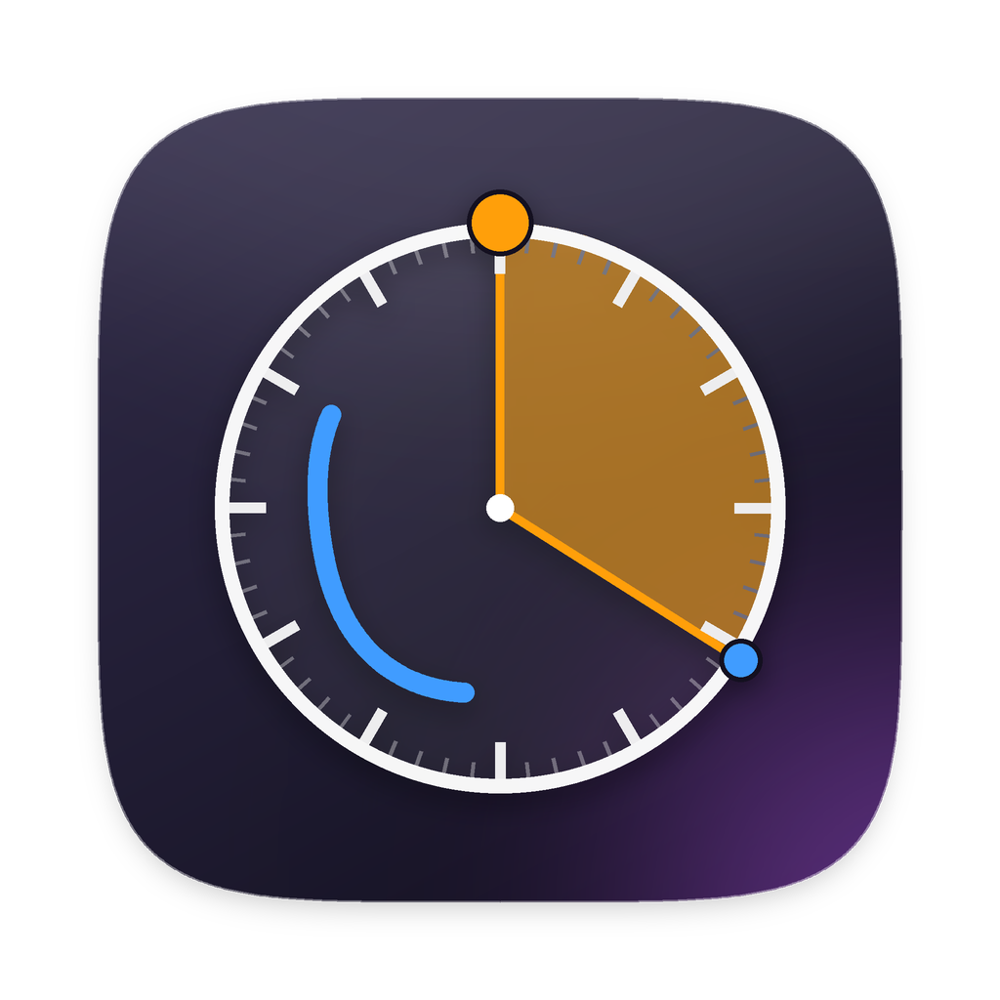

<p align="center">
  
</p>

<h1 align="center">ClockDraw</h1>

<p align="center">
  A tiny macOS menu bar app for planning your time by drawing on a clock face.
</p>

<p align="center">
  
</p>

---

Click the clock in your menu bar, mark where you are now and where you need to be, and scribble your plan right on the dial. No calendar, no accounts, no setup: just a clock you can draw on.

## Features

- **Lives in the menu bar.** One click opens it, another click hides it. No Dock icon.
- **Live time beads.** An orange bead (hour) and a smaller blue bead (minute) sit on the rim and move with the current time.
- **Time blocks.** Drag from one time to another and the slice fills in with its duration (e.g. `5h 40m`). Snaps to 5 minutes, works in both directions and across 12.
- **Pens and eraser.** Three pen colors and a stroke eraser that removes whole lines.
- **Undo / redo.** Toolbar buttons, `⌘Z` / `⇧⌘Z`, or a two-finger double-tap on the trackpad.
- **Pin on top.** Pin the window so it floats above everything. Unpinned, it hides when you click away.
- **Resizable.** Drawings scale with the clock, so nothing drifts out of place.
- **Auto-saved.** Whatever is on the clock when you quit is there when you come back. Clear it and it stays clear.
- **Launch at Login** from the menu bar icon's right-click menu.
- **Liquid Glass** on macOS 26 Tahoe, with a frosted-glass fallback on earlier versions.

## Install

### Download

1. Grab `ClockDraw.zip` from the [latest release](../../releases/latest), unzip it and move **ClockDraw.app** to `/Applications`.
2. ClockDraw is not notarized by Apple, so macOS will block it the first time. Either:
   - open it once, then go to **System Settings → Privacy & Security** and click **Open Anyway**, or
   - run this in Terminal:
     ```sh
     xattr -dr com.apple.quarantine /Applications/ClockDraw.app
     ```

### Build from source

Requires macOS 14+ and Xcode (or the Xcode Command Line Tools).

```sh
git clone https://github.com/erentatar8/ClockDraw.git
cd ClockDraw
zsh build_app.sh            # builds, installs to /Applications and launches
```

Use `zsh build_app.sh --no-install` to only produce `ClockDraw.app` in the project folder.

<details>
<summary>Working in Xcode</summary>

The Xcode project is generated from `project.yml` with [XcodeGen](https://github.com/yonaskolb/XcodeGen):

```sh
brew install xcodegen
xcodegen generate
open ClockDraw.xcodeproj
```

Build with Xcode 26 or later to get the Liquid Glass look.
</details>

## Usage

| Action | How |
| --- | --- |
| Open / hide | Click the clock icon in the menu bar |
| Menu (Launch at Login, Quit) | Right-click or Control-click the menu bar icon |
| Draw | Pick a pen color and drag on the clock |
| Time block | Pick the pie tool, then drag from start time to end time |
| Erase | Pick the eraser. It removes strokes if you start on a stroke, or time blocks if you start inside a block |
| Undo / Redo | `⌘Z` / `⇧⌘Z`, the arrow buttons, or a two-finger double-tap* |
| Clear everything | Trash button (undoable) |
| Quit | `⌘Q` while the window is focused |

\* The two-finger double-tap uses the system's Smart Zoom gesture. Turn it on in **System Settings → Trackpad → Scroll & Zoom → Smart zoom**. A two-finger double-click also works.

Your drawing is stored in `~/Library/Application Support/ClockDraw/strokes.json`.

## Project structure

```
Sources/ClockDraw/
├── ClockDrawApp.swift   # entry point (plain AppKit, no SwiftUI scenes)
├── AppDelegate.swift    # menu bar item, floating panel, pin, shortcuts, login item
├── ContentView.swift    # toolbar + drawing board
├── ClockFace.swift      # vector clock dial and time beads
├── DrawingModel.swift   # strokes, undo/redo history, auto-save
├── Wedge.swift          # time-block geometry and rendering
└── Glass.swift          # Liquid Glass with fallback, window background
```

Points are stored in normalized `0…1` coordinates relative to the clock, which is why drawings stay aligned when the window is resized.

## License

[MIT](LICENSE)
